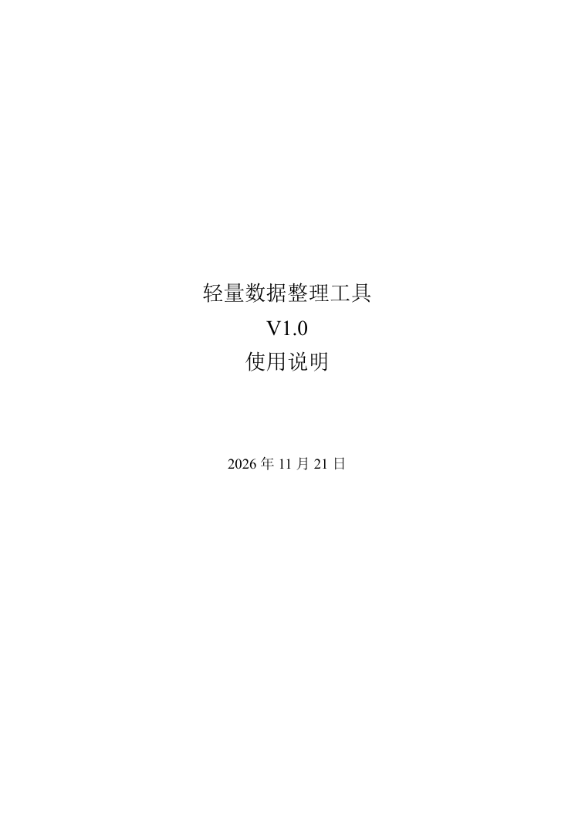
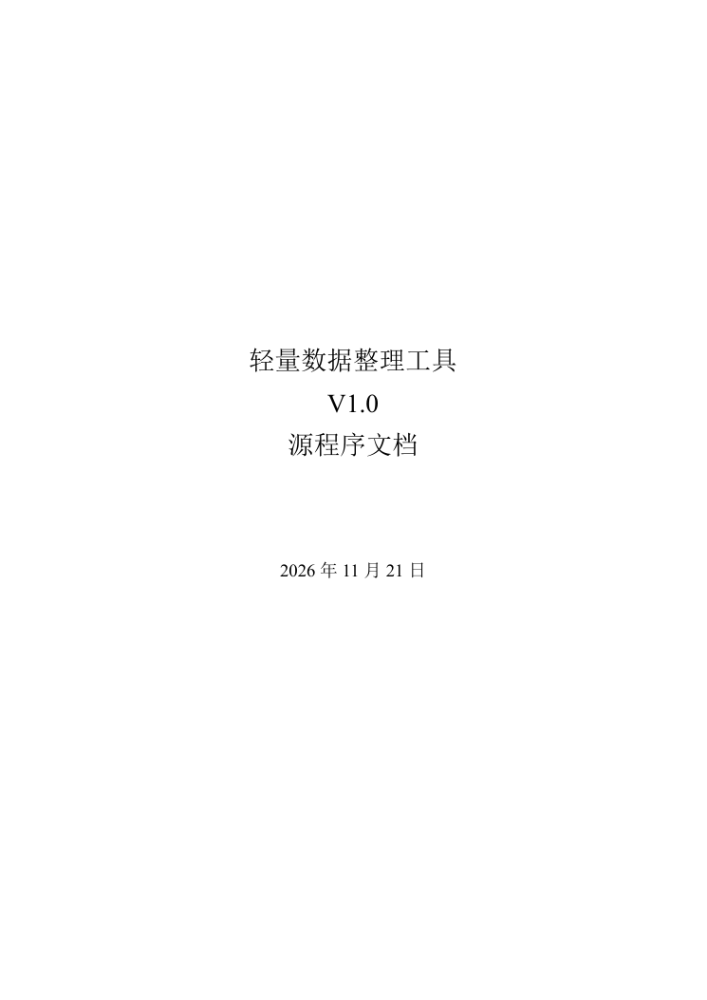

<div align="center">

# software-copyright-kit

**一套公开、可复用的软件著作权申请材料模板包**

说明书 · 源程序文档 · 申请表 · 编译工具链 · AI 分步提示词，全部打包好。克隆或下载后，把示例软件换成你自己的软件即可。

[](LICENSE)
[]()
[]()
[]()

</div>

软件著作权只在中国登记，所以本仓库的说明以中文为主。目标用户是课题组内外的研究生与开发者：照着模板改，就能得到一份格式合规、内容扎实的软著申请材料。

## 预览

左侧是说明书封面，右侧是源程序文档封面。正文各章都已写示范内容，编译即可出 PDF。

<p align="center">
  
  
</p>

## 这套模板解决什么

写软著材料时，最费劲的不是写代码，而是不知道说明书该写哪几章、每章写什么、源程序文档怎么排版才合规。本仓库把这些"隐性的格式知识"沉淀成模板：

- 每章顶部都写了写作指南，标明"写什么、必写还是可选、适用哪类软件"，照着写就行。
- 命令行软件和界面软件是两种使用方式，各自独立成章，按软件类型删掉用不到的那章。
- 源程序文档已按最新版去掉代码框（纯白底交存），用户手册保留代码框，两种样式都给了。
- 申请表只保留 `application.md`（不含 docx），mmd 架构图源文件留作参考。

## 特性

| 能力 | 说明 |
|------|------|
| 章节齐全 | 引言、安装、命令行使用、界面使用、架构、数据结构、附录，共7章 |
| 直接编译 | easybook 模板与分章 tex 就绪，改 settings 后 xelatex 即可出 PDF |
| 合规排版 | 源程序文档无代码框，手册带代码框，三线表、页眉页码符合交存习惯 |
| 工具链 | 编译、行数统计、抽页、查词、本地预览脚本一应俱全 |
| AI 全流程 | CLAUDE.md 加分步 prompt，AI 读一遍即可代写整套材料 |
| 去 AI 味 | 整合个人写作规范，软著、论文、推文通用 |

## 快速开始

```bash
git clone https://github.com/gxf1212/software-copyright-kit.git
cd software-copyright-kit
```

### 给 AI 用（推荐）

在仓库目录打开 AI 工具，说明你的软件信息，让它读 `CLAUDE.md`。流程是：收集信息 → 改 settings → 写各章 → 准备源码 → 写申请表 → 编译 → 核对验收。AI 会自己按步骤跑完。

### 手动用

1. 改 `software_copyright/settings.tex` 里的软件名和版本号。
2. 按软件类型在 `document.tex` 里注释掉用不到的章节。
3. 改写 `1-introduction.tex` 到 `7-appendix.tex`（每章顶部有注释指引）。
4. 源码放进 `software_copyright/src/`，复制到 `src_prod/` 后去空行，改 `code_simplified.tex`。
5. 填 `software_copyright/materials/application.md`。
6. 编译两份 PDF，检查每页行数。

```bash
cd software_copyright
bash ../softcopy-toolkit/compile.sh "$(pwd)/document.tex"
bash ../softcopy-toolkit/compile.sh "$(pwd)/source-code.tex"
```

## 目录结构

```
software-copyright-kit/
├── CLAUDE.md                 AI 全流程指南（给 AI 读）
├── software_copyright/       示例软著包（可直接编译）
│   ├── document.tex          用户手册主文件（带代码框）
│   ├── source-code.tex       源程序文档主文件（无代码框）
│   ├── settings.tex          软件名/版本/字体的唯一配置处
│   ├── 1-introduction.tex … 7-appendix.tex  七个章节模板
│   ├── images/               截图与架构图
│   ├── src/                  开发源码（唯一开发源）
│   └── materials/            application.md 申请表 + architecture.mmd 架构图
├── softcopy-toolkit/         编译、行数统计、抽页、查词工具
├── prompts/                  分步 prompt 与写作规范
└── assets/                   README 预览图
```

## 文档导航

- [CLAUDE.md](CLAUDE.md)：给 AI 读的全流程操作手册。
- [prompts/](prompts/)：分步 prompt（写说明书、写源程序、填申请表、核对润色）。
- [prompts/writing-style.md](prompts/writing-style.md)：中文写作规范（去 AI 味、标点空格、术语、软著专属）。
- [softcopy-toolkit/](softcopy-toolkit/)：工具链说明与脚本。

## 环境

需要 XeLaTeX 及中文字体。Ubuntu 示例：

```bash
sudo apt install texlive-xetex texlive-lang-chinese texlive-fonts-recommended \
                 texlive-latex-extra texlive-science poppler-utils
pip install -r requirements.txt
```

Windows 可用已安装的 TeX Live；`easybook.cls` 系列模板文件已随仓库提供，无需额外安装。

## 交存要点（以官方最新指引为准）

- 说明书与源程序都是前、后各连续30页；不足60页全交。
- 源程序每页不少于50行，文档每页不少于30行。
- 申请表、说明书封面、源码页眉的软件全称与版本号必须一致；界面截图上的名称也要一致。
- 不虚构内容凑篇幅；总量不足就全交。

## 许可

本仓库自有内容采用 MIT 许可，见 [LICENSE](LICENSE)。`easybook.cls`、`easybase.sty`、`eb-tcolorbox.cfg` 为第三方文件，采用 LaTeX Project Public License，见 [THIRD-PARTY-NOTICES.md](THIRD-PARTY-NOTICES.md)，请勿修改。

欢迎提 issue 和 pull request，也欢迎把本模板改成你自己的软著包。
